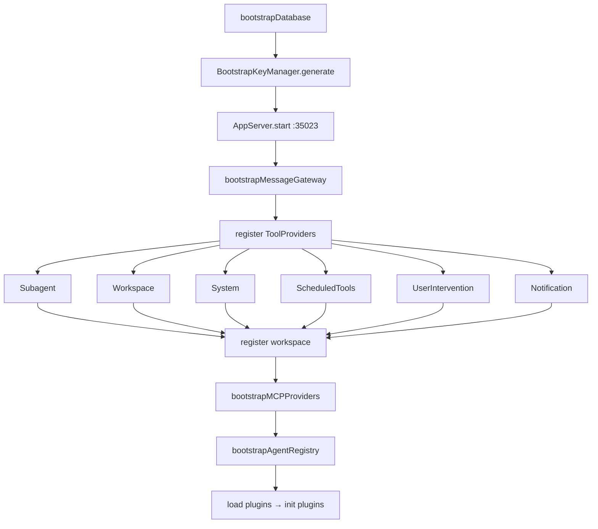
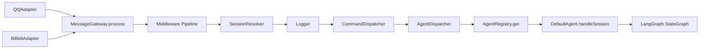
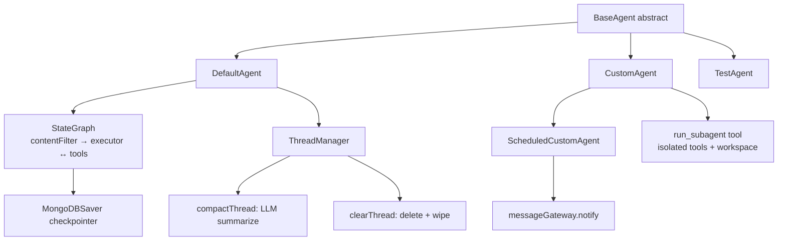
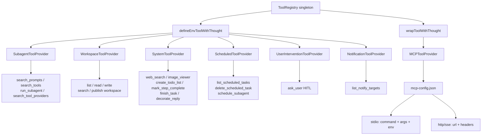
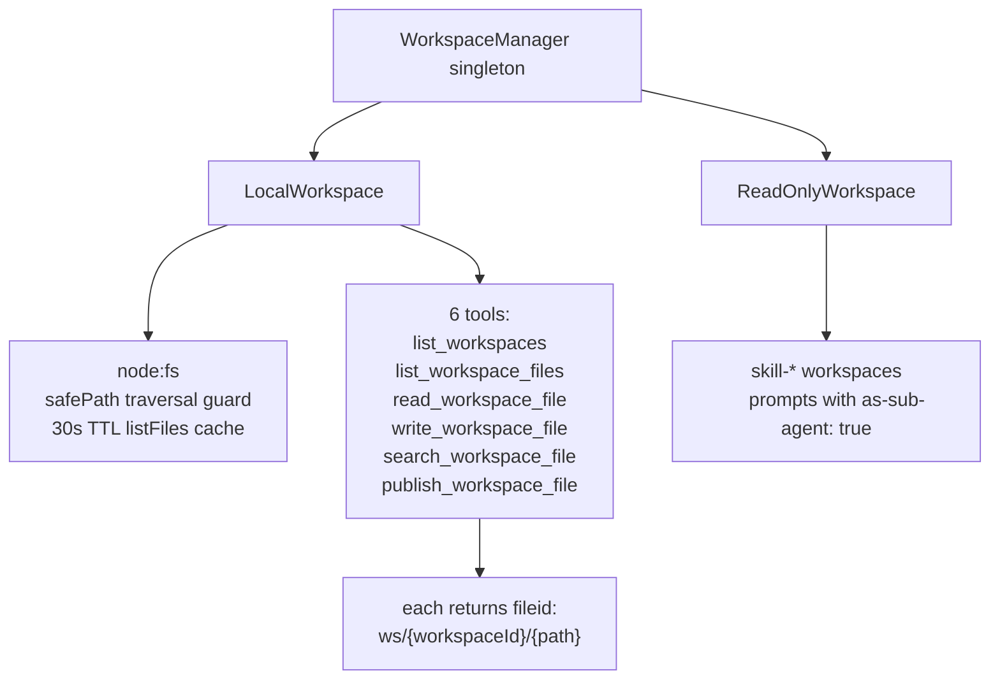
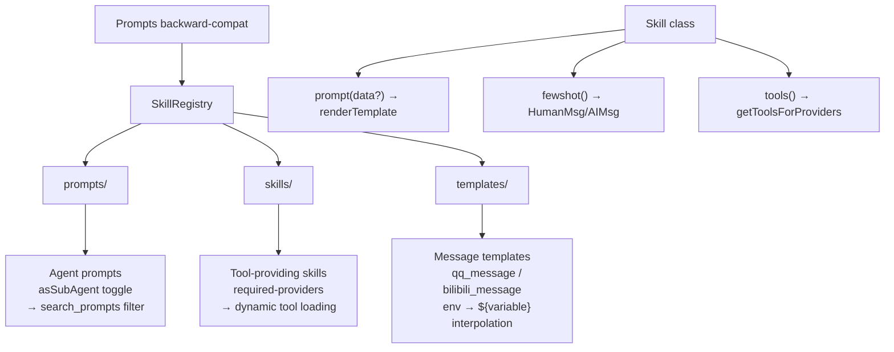
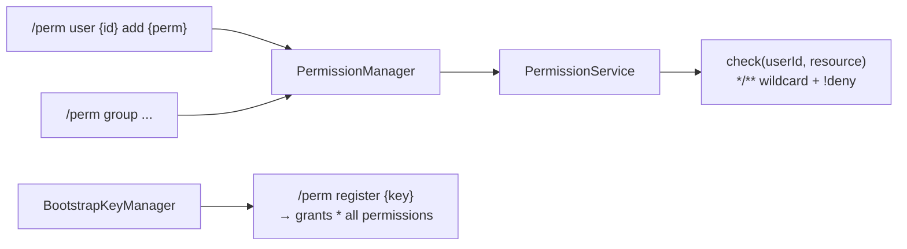
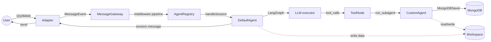
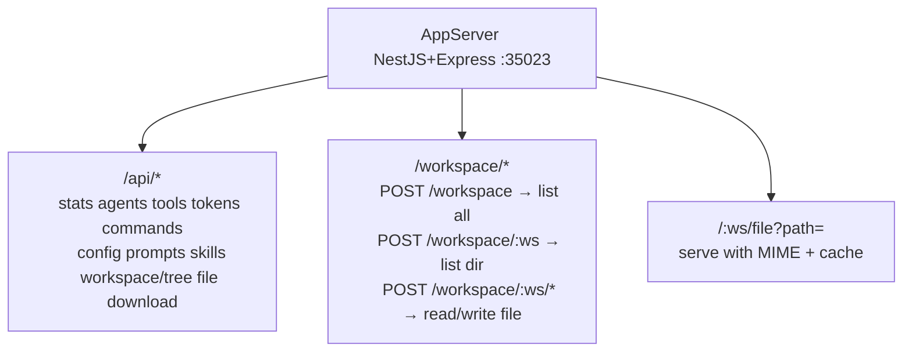
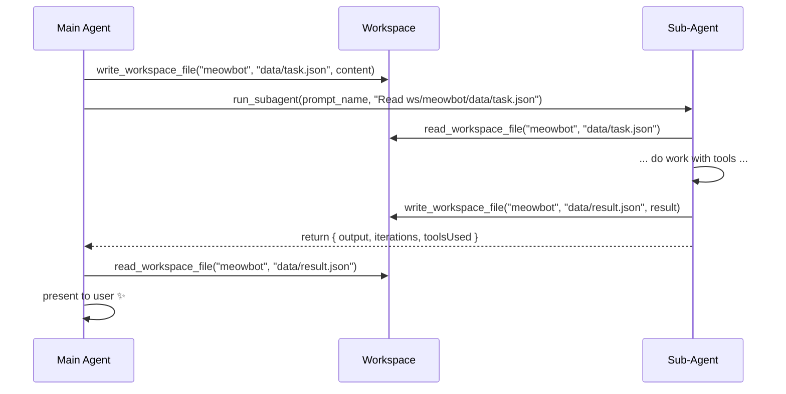

# MeowBot Core Architecture

## Startup Flow

## Message Flow

## Agent System

## Tool System

## Workspace System

## Template / Prompt System

## Permission System

## Data Flow Summary

## Server / API

## Workspace Data Exchange Pattern

