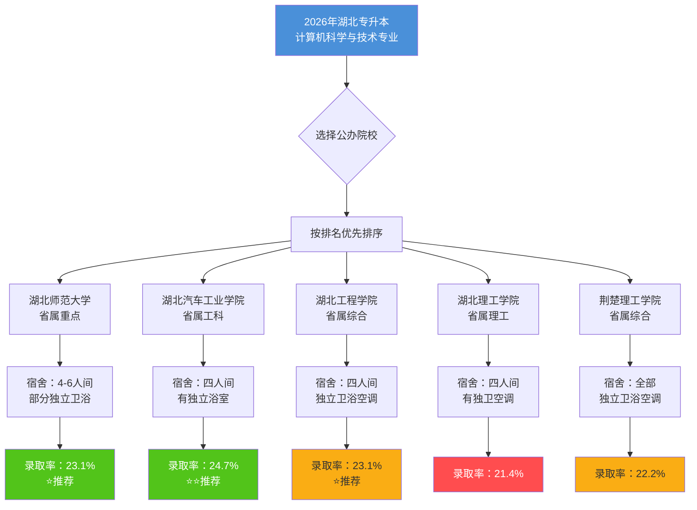

# 2026年湖北专升本计算机科学与技术专业 - 公办院校排序结果

## 排序标准：学校排名 → 宿舍条件 → 独立浴室 → 录取率从高到低

---

## 最终排序结果

| 排名 | 院校名称 | 学校定位 | 宿舍条件 | 独立卫浴 | 2025CS录取率 | 所在地 |
|------|---------|---------|---------|---------|-------------|-------|
| 1 | 湖北师范大学 | 省属重点师范 | 4-6人间，部分有独卫 | 部分有 | 23.1% | 黄石 |
| 2 | 湖北汽车工业学院 | 省属工科院校 | 四人间上床下桌，独立浴室 | 有 | 24.7% | 十堰 |
| 3 | 湖北工程学院 | 省属综合院校 | 四人间上床下桌，独立卫浴空调 | 有 | 23.1% | 孝感 |
| 4 | 湖北理工学院 | 省属理工院校 | 四人间，有独卫空调 | 有 | 21.4% | 黄石 |
| 5 | 荆楚理工学院 | 省属综合院校 | 宿舍均设独立卫浴空调 | 有（全部） | 22.2% | 荆门 |

---

## 详细说明

### 1. 湖北师范大学（推荐指数：⭐⭐⭐⭐）
- **学校排名**：省属重点本科院校，综合实力五校中最强
- **宿舍条件**：4-6人间，部分宿舍楼有独立卫浴（新宿舍条件好，老宿舍一般）
- **计算机专业录取率**：23.1%（188计划/815报考）
- **考试科目**：大学英语+C语言程序设计
- **注意**：2025年停招了15个专业，竞争压力增大

### 2. 湖北汽车工业学院（推荐指数：⭐⭐⭐⭐）
- **学校排名**：省属工科院校，以汽车工程为特色，十堰
- **宿舍条件**：四人间上床下桌，有独立浴室、热水供应、空调
- **计算机专业录取率**：24.7%（26计划/112报考）- 五校中录取率最高
- **考试科目**：大学英语+C语言程序设计
- **注意**：不限专业报考，竞争相对温和

### 3. 湖北工程学院（推荐指数：⭐⭐⭐）
- **学校排名**：省属综合院校，孝感
- **宿舍条件**：四人间上床下桌，配备空调热水独立卫浴
- **计算机专业录取率**：23.1%（81计划/351报考）
- **考试科目**：大学英语+C语言程序设计
- **注意**：招生计划相对较多

### 4. 湖北理工学院（推荐指数：⭐⭐⭐）
- **学校排名**：省属理工院校，黄石
- **宿舍条件**：四人间有独立卫生间，空调已基本全覆盖
- **计算机专业录取率**：21.4%（30计划/140报考）- 录取率最低
- **考试科目**：大学英语+C语言程序设计
- **注意**：竞争最激烈

### 5. 荆楚理工学院（推荐指数：⭐⭐⭐）
- **学校排名**：省属综合院校，荆门
- **宿舍条件**：所有宿舍均设有独立卫浴、空调、热水 - 五校中宿舍条件最好
- **计算机专业录取率**：22.2%（60计划/270报考）
- **考试科目**：大学英语+C语言程序设计
- **注意**：招生计划较多且在荆门市区，生活成本低

---

## 流程图

---

## 综合建议（给主人参考nya~）

- 如果想要**学校牌子**和**学历含金量** → 湖北师范大学（重点本科）
- 如果想要**录取率最高**+**宿舍条件好** → 湖北汽车工业学院（录取率最高24.7%）
- 如果想要**宿舍条件最好**+**生活成本低** → 荆楚理工学院（全部独立卫浴，荆门物价低）
- 如果想要**招生计划多** → 湖北工程学院（81人计划）
- ⚠️ 湖北理工学院竞争最激烈，录取率仅21.4%，谨慎报考
